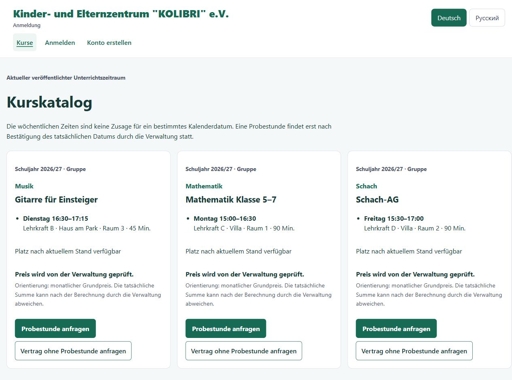
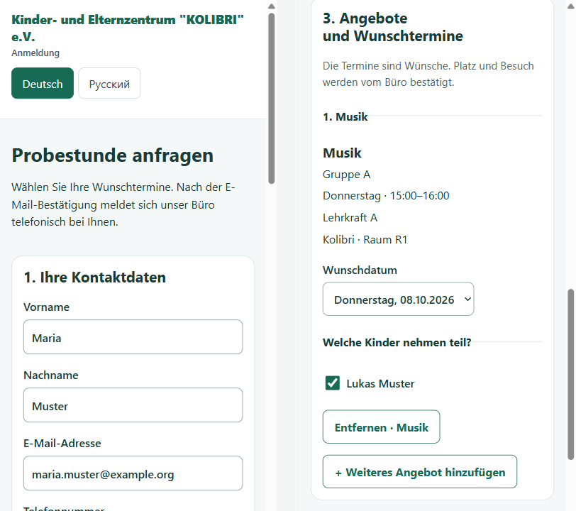

# Kolibri Registration Portal

Online registration for Kinder- und Elternzentrum Kolibri e.V. in Dresden, a centre with courses, clubs and tutoring for children and parents. Families find a course in the published timetable and request a trial lesson; the office confirms by phone. The larger parent portal, with accounts, contracts, documents and messages, is built on the same codebase and is still in development. The interface is in German and Russian.

| Course catalog | Trial lesson request on a phone |
| --- | --- |
|  |  |

*Screenshots from the synthetic test environment; courses, names and addresses are invented.*

## Status

- **Trial lesson requests** (`/probestunde`) were deployed in September 2026 as a separate, limited mode of the portal. The owner's acceptance test is the next step.
- **The parent portal** is in development. Its modules sit behind feature flags and release gates; having code for a module doesn't mean it is switched on.

The official Kolibri website is a separate system and links to the portal over plain HTTPS.

## What's in it

**Trial lesson intake** (`PORTAL_MODE=trial_intake`): parents choose offers from the timetable, add their children and preferred dates, and confirm their email address; no account is needed. The office gets the request by email and Telegram, with an email fallback when a Telegram message fails. Admins see requests and the delivery status of every notification.

**Parent portal**: accounts with revocable sessions, family and child records, claims to records from the old system, the course catalog with indicative prices, trial and individual tutoring requests, document upload with quarantine and review, contract offers, price reviews, messages, an admin area, an audit log, and privacy export and deletion.

**Underneath**: versioned imports of price tables, timetables and the old Access database (dry run, promotion, rollback), D1 migrations, private R2 storage, an outbox for email and Telegram, scheduled maintenance jobs, a health endpoint, and ownership and role checks on the server for every request.

## Stack

- Svelte 5, SvelteKit 2, TypeScript, Tailwind CSS, Zod
- Cloudflare Workers, D1, R2, and Browser Run for contract PDFs
- Resend, Cloudflare Turnstile and the Telegram Bot API in configured environments
- Vitest for unit and integration tests, Playwright for browser tests

## Running it locally

You need Node.js 22.12 or later. Install with `npm ci` so you get the exact dependency versions from `package-lock.json`, including a pinned pre-release of Miniflare.

```sh
npm ci
npm run db:migrate:local
npm run dev -- --host 127.0.0.1
```

Open the URL that Vite prints, usually `http://127.0.0.1:5173`. The migration scripts only touch the local D1 database in the ignored `.wrangler/` folder; `wrangler.local.toml` names the local resources, and remote bindings are switched off.

The local setup starts the full portal with public login, document and contract features disabled, a fake email provider and no Telegram. A fresh database has no catalog, imports, families or admin account, so it is a starting point for development rather than a filled demo.

- Copy `.dev.vars.example` to the ignored `.dev.vars` only when a feature needs local secrets, and fill in local values. Production or preview credentials never go into tracked files.
- `npm run db:migrations:local` lists the local migrations; `npm run db:reset:local` deletes the local database.
- Turning a feature on takes its real configuration and prerequisites, not just its flag.

### Imports

The import tools read price tables, timetables, the Access database and selected PlusBText fields into a registered academic period. The period is never guessed from file names or dates; create one first, for example:

```sh
npm run db:period:local -- --academic-period 2026-2027 --display-name 2026/2027 --starts-on 2026-08-01 --ends-on 2027-07-31
```

The `import:*:local` commands support dry runs, promotion, status and rollback; a dry run doesn't change the active version. Source files are private and not part of the repository. They are read with allowlisted parsers that never open Office files or run embedded macros. Read [data sources](docs/operations/DATA_SOURCES.md) and [the import pipeline](docs/operations/IMPORT_PIPELINE.md) first.

## Configuration and deployment

| File | Purpose |
| --- | --- |
| `wrangler.local.toml` | Local D1 and R2 bindings and restricted feature defaults |
| `wrangler.e2e.toml` | Synthetic runtime for the browser tests |
| `wrangler.adapter.toml` | Build output configuration, not a deployment target |
| `wrangler.example.toml` | Shape of a full portal deployment, with placeholders |
| `.dev.vars.example` | Placeholders for local secrets |
| `deploy/trial-intake/wrangler.example.jsonc` | Separate deployment shape for trial intake |

The tracked templates contain no resource IDs or credentials; real deployment configuration is kept in ignored files. `src/worker.ts` wraps the SvelteKit Worker and adds scheduled jobs and the health endpoint. `npm run build` creates the deployment artifacts, and `npm run deploy` changes a live Worker, so it follows the release procedure in [the deployment runbook](docs/operations/PRODUCTION_DEPLOYMENT.md). See also [trial intake deployment](deploy/trial-intake/README.md), [production readiness](docs/operations/PRODUCTION_READINESS.md) and [disaster recovery](docs/operations/DISASTER_RECOVERY.md).

## Tests and checks

```sh
npm run test:unit
npm run test:integration
npm run test:intake-release
npm run test:e2e
```

Browser tests run against a synthetic environment with fake providers. Two checks guard every change, including documentation:

```sh
npm run docs:check
npm run release:scan
```

`docs:check` validates local links, the commands shown in the docs and the continuity of the stage records. `release:scan` blocks prohibited artifacts and likely secrets or personal data in tracked files. Which tests a change needs is defined in [AGENTS.md](AGENTS.md) and [the test plan](docs/implementation/TEST_PLAN.md).

## How it's built

This portal is developed with AI coding agents, and the history shows it: most commits are authored by Codex, the agent that wrote the code. My part is the product and engineering side:

- the [specification](docs/spec/MVP_SPEC.md) and the record of [product decisions](docs/spec/OPEN_QUESTIONS.md), where an open question never silently becomes a business rule;
- the architecture, the data model and the security rules: server-side ownership checks, an audit log, append-only migrations, idempotent imports;
- splitting the work into stages with acceptance criteria, reviewing each stage and deciding when it ships.

[AGENTS.md](AGENTS.md) holds the working rules the agents follow. `docs/implementation/` keeps the stage plans, the traceability matrix, handoff notes between sessions and the current checkpoint, so every step can be traced and resumed.

## Project layout

- `src/routes/` public, parent and admin pages
- `src/lib/server/` services, authorization, data access, imports, providers and operations
- `src/lib/trial-intake/` the trial lesson intake
- `migrations/` D1 schema migrations
- `scripts/` local tooling, documentation and release checks, operational commands
- `tests/` unit, integration and browser tests with synthetic data
- `deploy/trial-intake/` deployment template and notes for the intake
- `integrations/schedule-exporter/` export of timetable links from the schedule tool
- `docs/` requirements, architecture, domain rules, runbooks and stage records (mostly Russian)
- `references/` descriptions of the source data; the source files themselves are not included

Start with the [documentation map](docs/README.md).

## License

[MIT](LICENSE). The embedded DejaVu font subset keeps its own [license](docs/licenses/DEJAVU_FONTS_LICENSE.txt).
