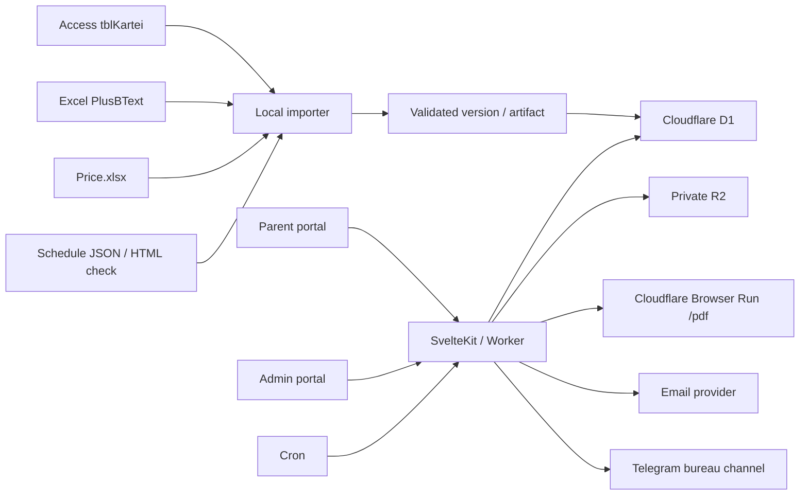

# Архитектура

## Системные границы



Worker никогда не обращается к локальным host/сетевым дискам. Локальные файлы
обрабатываются только importer-скриптами вне runtime. D1 является
runtime-источником истины; upstream-файлы остаются источниками очередных версий
импорта.

## Компоненты

### Runtime Cloudflare

- SvelteKit parent portal и admin UI;
- server routes/API с Zod-валидацией;
- auth/session, CSRF, RBAC и ownership middleware;
- D1 repositories и транзакционные/conditional state transitions;
- приватные R2 upload/download adapters;
- contract HTML/PDF adapter через Cloudflare Browser Run Quick Action и
  immutable R2 artifacts;
- email и Telegram outboxes;
- cron для retry, expiry и технических задач.

### Локальный importer

- читает Access через установленный ACE/ODBC driver;
- читает `Price.xlsx` и только необходимые листы клиентского workbook;
- читает JSON snapshot расписания, а HTML использует для визуальной сверки;
- пишет обезличенный validation report;
- создает staging version и публикует ее только после полной проверки;
- не помещает source dump с PII в repository, logs или build artifacts.

Подробный pipeline: [IMPORT_PIPELINE.md](../operations/IMPORT_PIPELINE.md).

## Рекомендуемая структура server-кода

```text
src/lib/server/
  auth/             # hashing, JWT/session, verification/reset tokens
  db/               # repositories and state transitions
  imports/          # runtime metadata/promotion support
  courses/          # catalog, classification, capacity, mappings
  pricing/          # normalization, lookup, quotes, review batches
  contracts/        # offers, artifacts, acceptance, activation
  requests/         # trial, Nachhilfe, individual
  documents/        # private R2 and metadata
  messages/         # support, absence, outboxes
  email/            # provider adapter and templates
  security/         # CSRF, Turnstile, rate limits, audit helpers
```

Local scripts находятся в `scripts/import-*` и используют чистые функции из
отдельного Node-compatible слоя, который можно тестировать без D1 и реальных
PII-файлов.

## Потоки состояния

### Версионируемые справочники

Price и schedule сначала создают неактивную version. После validation D1
атомарно переключает указатель текущей версии. Неуспешный run не меняет каталог
или расчет цены. Старые версии остаются доступны для contract/quote snapshots и
аудита.

### Mutable workflow

Claims, requests, trials, offers, enrollments и review items изменяются только
разрешенными переходами статусов. Каждый опасный переход:

1. проверяет actor и ownership;
2. проверяет текущий status/version;
3. использует idempotency key или уникальное ограничение;
4. меняет связанные записи одной транзакцией/conditional batch;
5. пишет audit event;
6. создает outbox-запись вместо надежды на синхронный внешний API.

## Безопасность

- deny-by-default для server routes;
- admin role невозможно получить из публичного payload;
- `HttpOnly` auth cookie + CSRF для state-changing requests;
- Turnstile и rate limiting на публичных формах;
- object-level ownership для детей, документов, заявок и договоров;
- R2 bucket приватный, object keys случайные;
- query parameters и SQL параметризованы;
- audit/log redaction исключает PII, токены и содержимое документов;
- source PII никогда не отправляется клиенту до verified claim.

## Время и деньги

- audit timestamps — UTC;
- recurring schedule хранит local wall time и timezone `Europe/Berlin`;
- trial/effective/start dates — локальные календарные даты;
- все деньги — integer cents, currency `EUR`;
- операции цены не используют JavaScript binary float для округления денег.

## Среды и конфигурация

Нужны раздельные local/preview/production D1 и R2 и Browser Run binding.
Production secrets задаются
через Cloudflare secrets. При отсутствии `JWT_SECRET`, Turnstile secret или D1
приложение должно fail closed. Отсутствие email/Telegram credentials не должно
терять доменное действие: outbox остается в ошибочном/ожидающем состоянии и
виден администратору.

Browser Quick Action требует compatibility date `2026-03-24` или новее и remote
mode для integration development. Unit tests используют fake renderer; remote
spike и budget/DPA check обязательны перед production contracts.

Deploy и production migration не являются частью обычного этапа реализации и
выполняются только по отдельному разрешению.

## Использование старого проекта

Локальная ignored `references/current_app/`, если доступна, используется только
для изучения инфраструктурных паттернов Cloudflare, auth, CSRF, Turnstile,
email, R2 и UI. Старые таблицы и процессы
`events`, `registrations`, `reviews` не переносятся. Любой скопированный паттерн
должен быть повторно проверен по требованиям этого проекта.
