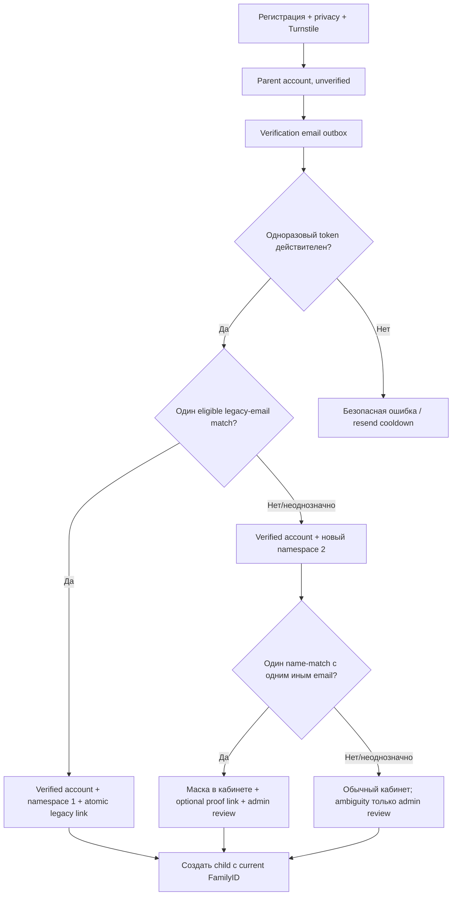
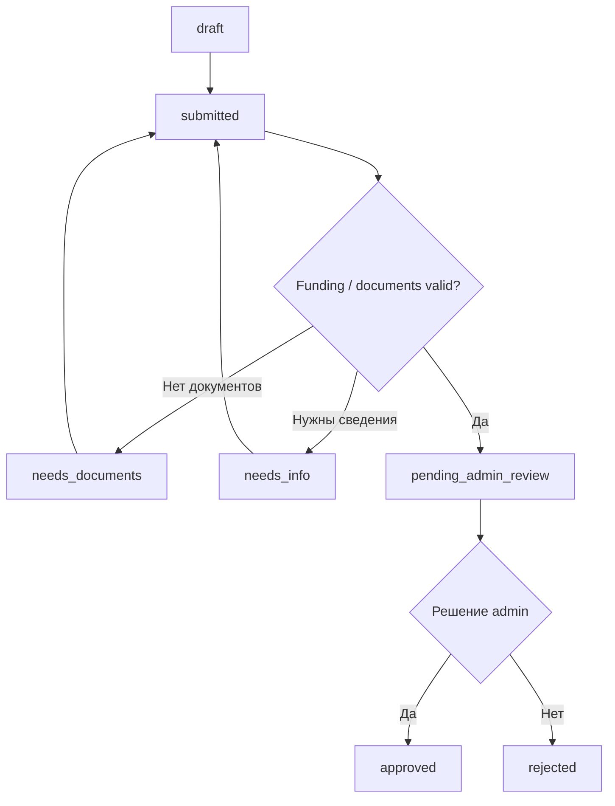

# Пользовательские и административные процессы

Таблицы ниже задают разрешенные состояния. Любой иной переход отклоняется на
сервере и при необходимости создает audit/review task.

## Регистрация и ребенок



Unverified account не имеет current FamilyID. Первая успешная verification
завершает регистрацию и атомарно назначает его по `CLAIM-02`. Verified parent
может создать portal child с именем и датой рождения; create transaction обязана
скопировать current `family_number_id` аккаунта, иначе child не создаётся.
Изменение portal child разрешено owner. Изменение legacy child оформляется как
correction request/admin action. Approved correction записывается как override
поверх отдельно сохраненного source value; reimport обновляет source, но не
стирает override.

## Legacy claim

1. До verification система не делает observable lookup; family assignment
   остаётся `pending_verification`.
2. При успешной verification conditional transaction повторно проверяет current
   email и promoted legacy snapshot. Ровно одна eligible unowned family с exact
   normalized email становится current namespace `1`; её children/future
   enrollments связываются идемпотентно. При нуле или неоднозначности выделяется
   один новый namespace `2`; ambiguity создаёт review. Нет current promoted
   snapshot, lookup/import error или concurrent promotion — вся transaction
   откатывается, token остаётся повторяемым, а отсутствие данных не считается
   нулём matches.
3. После namespace `2` система проверяет только детерминированный parent-name
   match. Ровно одна не принадлежащая другому account family с ровно одним иным
   usable email даёт предложение в кабинете; любое name-match одновременно
   создаёт admin review. Список
   неоднозначных кандидатов parent не показывается.
4. Маска для обычного local part длиной не менее четырёх символов содержит
   первые два символа, фиксированное `*****`, последний символ и полный domain;
   короткий local part скрывается строже. Полный адрес существует только в
   server-side candidate/outbox path и не попадает в URL, UI, audit diff или log.
5. Parent явно запрашивает proof. Одноразовый hashed token отправляется на
   legacy-email, связан с user/candidate/current-family version, имеет TTL,
   cooldown и rate limit. Применение требует authenticated session того же user.
6. Успешный conditional transaction повторно проверяет candidate/ownership,
   claim-ит legacy family, переводит namespace `2` в historical alias,
   назначает namespace `1` аккаунту и всем его children и связывает legacy data.
   Invalid/expired/replayed token или race не меняет ни одной связи и при
   необходимости создаёт review task.
7. Несколько families по email/name, несколько distinct candidate emails,
   collision и already-owned family никогда не выбираются автоматически.
8. Reimport обновляет source data, но не отнимает owner и не стирает manual
   correction.
9. Новый academic period с тем же непротиворечивым `source_namespace+FamilyID`
   наследует claim/owner и stable children; period enrollment snapshots
   создаются заново.
10. Контактный/child конфликт, смена или ошибочное повторное использование
   `FamilyID` создаёт continuity review без автоматической передачи owner.

Последующая смена login-email сама по себе не меняет FamilyID. Name-only не
является доказательством владения, global child-name match и автоматическая
передача already-owned family запрещены.
Новый exact-email match, впервые появившийся после reimport/profile change, не
переключает current family в background job: он создаёт typed review и проходит
тот же explicit proof/admin reassignment boundary.

## Административное исправление FamilyID

Admin выбирает не строковый номер, а существующую validated family allocation
из legacy search либо новый номер через штатный namespace-2 allocator. Preview
показывает source/destination, affected children, active/nonterminal services и
contracts, ownership/collision warnings и операции supersede; полный diff
доступен только admin и не попадает в общий audit payload.

После обязательных reason, explicit confirmation и idempotency key одна
conditional transaction:

1. блокирует ambiguous/colliding destination и destination, принадлежащую
   другому active account, без отдельного разрешения ownership conflict;
2. меняет current family аккаунта и `family_number_id` всех его детей;
3. связывает approved legacy records, а прежний allocation оставляет historical
   alias, не вторым current FamilyID;
4. supersede-ит незаключённые offers со старым family snapshot;
5. сохраняет immutable historical contract numbers/PDF/certificates и audit.

Будущие offers используют sequence нового current FamilyID. Ошибка любого шага
откатывает всю операцию и оставляет review task.

## Trial

| Текущее состояние | Действие | Новое состояние |
| --- | --- | --- |
| — | Parent submits | `requested` |
| `requested` | Admin confirms date/capacity | `confirmed` |
| `requested` | Admin rejects with reason | `rejected` |
| `requested|confirmed` | Parent/admin cancels | `cancelled` |
| `confirmed` | Admin records attendance | `attended|no_show` |
| `attended` | Admin starts contract workflow | `converted` |

Только одна open trial на child/course. Confirming проверяет future date,
ownership, отсутствие active enrollment и актуальное состояние capacity. Full
group остается ручным request, а не waitlist.

## Nachhilfe и individual



| Текущее состояние | Действие | Новое состояние |
| --- | --- | --- |
| — | Parent creates | `draft` |
| `draft|needs_documents|needs_info` | Parent submits/resubmits | `submitted` |
| `submitted` | System detects missing required files | `needs_documents` |
| `submitted` | Validation complete | `pending_admin_review` |
| `pending_admin_review` | Admin requests files/details | `needs_documents|needs_info` |
| `pending_admin_review` | Admin decides | `approved|rejected` |
| `draft|submitted|needs_documents|needs_info|pending_admin_review` | Parent cancels | `cancelled` |
| `approved` | Parent/admin cancels before contract/enrollment | `cancelled` |

`draft` можно сохранить без документов. Submitted `individual` всегда
`self_pay`. Submitted `nachhilfe` всегда `jobcenter|socialamt` и требует минимум
один допустимый document перед admin review; self-pay Nachhilfe отклоняется с
переходом к individual request. Для approved public-funding authorization
обязательны funding kind и inclusive valid dates. Payer name/reference и
approved-hours fields не копируются; они остаются в документе, а фактические
часы не рассчитываются в MVP.

`group_nachhilfe` создается только admin и не возникает автоматически из
обычного request.

Funding authorization проходит
`pending_review -> approved|rejected`; approved может стать `revoked` либо
атомарно `superseded` при approval новой version. Истечение вычисляется по
inclusive `valid_until`, не отдельным mutable status. Approval, offer send и
activation требуют хотя бы один current document и только `approved` document
states; изменённый документ после approval создаёт новую version/evidence и не
перезаписывает старую.

Referenced sent/contract document нельзя заменить/удалить parent action: новая
загрузка создаёт authorization version. Revocation/supersede/expiry active
funding supersede open offers и переводит active engagement в `funding_review`
с admin task, но не переписывает и не прекращает contract. Продолжение требует
новой approved authorization и явного admin funding amendment; если меняются
parent-facing terms, выпускается новый offer с parent acceptance.

### Document quarantine

Upload сначала получает `quarantined`. MIME/signature/size validation может
отклонить его, но не делает файл безопасным. Parent не получает прямой/public
R2 URL ни в одном состоянии; до clean attestation нет inline preview.

Утверждённый ручной MVP-flow:

1. уполномоченный admin получает short-lived forced attachment с opaque именем
   и short SHA-256; download аудируется и не открывает документ на сайте;
2. admin локально проверяет ровно этот artifact актуальным approved antivirus;
3. отдельное подтверждение фиксирует hash, admin, scanner label, attestation
   text version и время; clean attestation переводит `quarantined -> clean`, а
   обнаруженная угроза — в `infected|rejected`;
4. только из `clean` выполняется отдельный business review
   `clean -> approved|rejected`; нерелевантный/нечитабельный документ получает
   reason и request-reupload.

Ручная кнопка не доказывает результат AV криптографически и потому требует
runbook/training/audit. Production upload включается только после реализации и
тестового прохода этого flow. Не получивший `approved` object становится
eligible для удаления при `now >= uploaded_at + 14×24h` UTC и удаляется первым
успешным cleanup после порога, но не раньше; повторное скачивание TTL не
продлевает.
Абстрактные `scan_pending|suspicious|scan_failed` резервируются для будущего
автоматического scanner adapter, но manual clean их не использует. Полная
изоляция описана в
[STORAGE_AND_UPLOAD_SECURITY.md](../operations/STORAGE_AND_UPLOAD_SECURITY.md).

## Contract offer

| Текущее состояние | Actor/action | Новое состояние |
| --- | --- | --- |
| — | Admin creates | `draft` |
| `draft` | Generate immutable HTML/PDF, validate snapshots, send | `sent` |
| `sent` | Parent accepts current hash before expiry | `accepted_by_parent` |
| `sent` | Parent declines | `declined_by_parent` |
| `sent` | Deadline passes | `expired` |
| `draft|sent` | Admin cancels | `cancelled` |
| `sent` | Conditions replaced by new version | `superseded` |
| `accepted_by_parent` | Admin approves/forms and activates transactionally | `approved_by_admin` |
| `accepted_by_parent` | Admin cancels with reason when activation is impossible | `cancelled` |
| `accepted_by_parent` | Conditions changed; admin creates new version | `superseded` |

После `sent` offer immutable. Новые условия означают новую version, старую
принять нельзя; acceptance старой version не переносится. Parent-side
accept/decline требует current active role `parent`. Acceptance и activation
имеют разные idempotency keys, а admin activation actor обязан отличаться от
parent actor/owner даже после role promotion. Activation атомарно:

- проверяет acceptance/hash/owner/current status;
- фиксирует formation timestamp и обе стороны evidence;
- создаёт immutable source record отдельного formation certificate; его PDF
  рендерится/доставляется обеим сторонам отдельно от неизменного offer PDF;
- для group повторно проверяет price/capacity, создаёт/активирует один
  enrollment, связывает represented legacy enrollment и один раз обновляет
  occupancy;
- для individual/Nachhilfe повторно проверяет request/funding status и
  conditional переводит уже связанный draft/contract_offered service
  engagement в active и связывает contract, не меняя group occupancy;
- создаёт audit; только group branch при необходимости создаёт deduped price
  review batch.

Group enrollment использует
`draft -> contract_offered -> active -> ended|cancelled`; pre-active record
также можно cancel. Pause/resume в MVP отсутствуют. Создание или
изменение future effective boundary одновременно планирует deduped price review
на эту дату; reconciliation job безопасно восстанавливает пропущенный signal.

Первый individual/Nachhilfe offer series атомарно создаёт draft engagement.
Superseding version переиспользует его. Cancel/decline/expiry последнего open
offer очищает/отменяет неактивный engagement; active record cleanup не затрагивает.

### Widerruf, Kündigung и mutual termination

| Вид | Действие parent | Реакция системы/admin |
| --- | --- | --- |
| `withdrawal` | Отправляет statutory Widerruf в применимый срок | Система сразу фиксирует receipt/hash/time, прекращает contract по утверждённой policy и отправляет durable confirmation; admin approval/debt check не требуется |
| `ordinary_termination|extraordinary_termination` | Указывает contract, вид и желаемую/самую раннюю дату | Система сразу фиксирует и подтверждает получение; admin устанавливает calculated effective date либо `disputed`, но не отклоняет сам факт receipt |
| `mutual_termination_request` | Просит прекратить раньше договорной даты | `received -> approved|declined`; необходимость переписки/звонка создаёт отдельную admin task, а внешний debt check может быть условием соглашения, но не меняет ordinary Kündigung |

Каждый request/event immutable и idempotent, а email confirmation идёт через
outbox. Долг не моделируется в портале: допускается только manual attestation с
reason/audit для mutual request. Для `group_monthly` receipt в месяце M означает
effective end в последний день M; для `group_yearly` receipt до contractual end
запрещает последующее auto-renewal, но не сокращает term.

Для individual/Nachhilfe notice «больше не посещаем» сразу завершает service
engagement и закрывает future undelivered units; после receipt новые требования
за них невозможны. Сам contract не обязан автоматически считаться формально
расторгнутым: optional Kündigung отправляется отдельным request. Уже
согласованный lesson может остаться к внешнему ручному выставлению только если
teacher фактически пришёл/начал ждать раньше receipt notice. Receipt до прихода
teacher исключает требование; произвольного cutoff в минутах нет. Система
сохраняет receipt и attested arrival/waiting evidence, но не вычисляет charge.

Statutory Widerruf — отдельный legal-profile branch, а не вариант attendance
notice. Online send разрешён только template version с approved profile. Для
`widerruf_applicable` доступны public § 356a flow, immediate durable confirmation
и отдельный early-performance request; для
`widerruf_not_applicable_312g_2_9` хранится approval evidence/notice;
`offline_only` запрещает online send. § 312k включается согласно тому же
утверждённому profile.

### Media consent withdrawal

Portal разрешает отдельный `grant|decline` по ребёнку, capture type и
publication channel, но не показывает self-service revoke и не публикует такой
parent API. Withdrawal принимается лично в бюро по адресу из официального
Impressum, по официальному email либо телефону со страницы Kontakt.

```text
granted --office/email/phone received--> revoked
granted --successful account deletion--> revoked
```

- admin выбирает ребёнка/current grant, scopes и channel и фиксирует реальный
  `received_at` после обычной проверки связи с owning parent; это регистрация
  факта без approve/decline, без раскрытия child data звонящему;
- `effective_from` всегда равен receipt time, даже если admin ввёл запись позже;
- повтор одного обращения dedupe-ится, а исправление создаёт superseding event
  с audit;
- account deletion атомарно создаёт revoke для всех current grants с timestamp
  удаления до минимизации profile/child links;
- revoke запрещает только новые capture/upload/post/repost/reprint по
  отозванным scopes; портал не ищет media files и старые публикации;
- конкретно названный старый URL/post создаёт отдельный
  `media_content_request`, а не меняет consent event и не обещает automatic
  takedown.

После ручной регистрации система ставит durable confirmation в email outbox,
если usable email ещё доступен. Ошибка доставки не откатывает revoke. Текст и
contacts берутся из approved versioned configuration со ссылками на
Impressum/Kontakt.

## Price review

1. Триггер создает один batch на course/reason/count/effective date.
2. Система пересчитывает каждый active enrollment, но создаёт клиентский item
   только если current accepted final price или mode отличается от предложения;
   triggering enrollment с уже актуальной ценой исключается.
3. Admin может исправить/отменить item и первым действием approve рассылку.
4. Notification outbox отправляет каждому только его item и private cabinet
   link; response deadline равен 14 календарным дням.
5. `sent -> accepted_by_parent|declined_by_parent` требует current active role
   `parent`; decline немедленно создаёт admin notification/manual-contact task,
   timeout — overdue task.
6. `accepted_by_parent -> approved_by_admin` требует второго явного действия
   admin с другим user ID по конкретному item; batch approval и последующее
   повышение роли ответившего parent его не заменяют.
7. Final confirmation и apply повторно проверяют active account/enrollment,
   old price/mode, group count, price/rule version и отсутствие newer item;
   mismatch делает item `superseded` без price mutation.
8. Только revalidated `approved_by_admin` получает `scheduled_for` — первое
   число следующего календарного месяца после final confirmation в
   `Europe/Berlin` — и применяется один раз в эту дату без retroactivity.

Если изменившийся count не меняет ни одной принятой цены/mode, batch завершается
без сообщений. Claimed legacy-only service с однозначным owner/mapping и
известной/подтверждённой price проходит тот же email/accept/confirm/apply flow;
apply добавляет effective legacy-price assignment, не переписывая source row и
не создавая digital contract/PDF. Unknown/unclaimed/conflicting legacy получает
только `manual_contact_required`.

Каждый новый trigger supersede несовместимые open items предыдущих batches.
Поздний ответ на stale hash фиксируется безопасно, но не оживляет item и не
переносит acceptance на новый snapshot.

После отправки item immutable и принимается по hash. Любое изменение цены,
effective date или текста создает новую version, а прежняя становится
`superseded`.

Старая цена действует до успешного применения. Ретроактивное изменение
запрещено. Одинаковая state machine действует для yearly/monthly и increase/
decrease; response одного item не меняет другие.

## Support и absence

Обычное обращение создает thread/message. Absence form дополнительно требует
child, enrollment и дату и атомарно создает связанную `absence_report` и message
в thread. Ответ admin сначала сохраняется, затем ставится в email outbox.

| Текущее состояние | Actor/action | Новое состояние |
| --- | --- | --- |
| —/`open` | Parent сохраняет первое сообщение | `waiting_for_admin` |
| `waiting_for_admin` | Admin отвечает и ожидает уточнение | `waiting_for_parent` |
| `waiting_for_admin` | Admin дает финальный ответ | `answered` |
| `waiting_for_parent|answered` | Parent пишет продолжение | `waiting_for_admin` |
| Любое незакрытое | Parent или admin закрывает | `closed` |

`open` допустим только как краткое draft/transactional состояние до первого
message. В `closed` новые сообщения не добавляются; продолжение создает новый
thread со ссылкой на предыдущий. Повтор ответа/закрытия идемпотентен.

Подробности доставки: [MESSAGING.md](MESSAGING.md).
