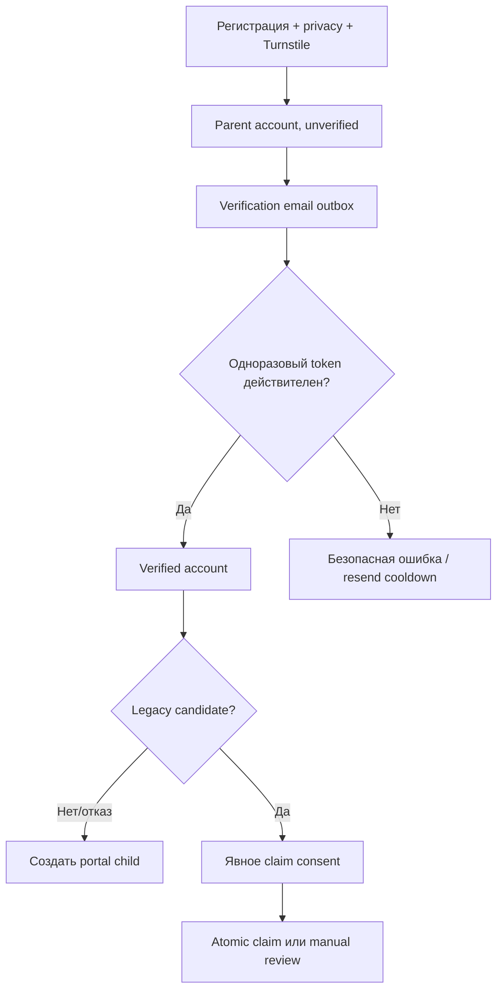
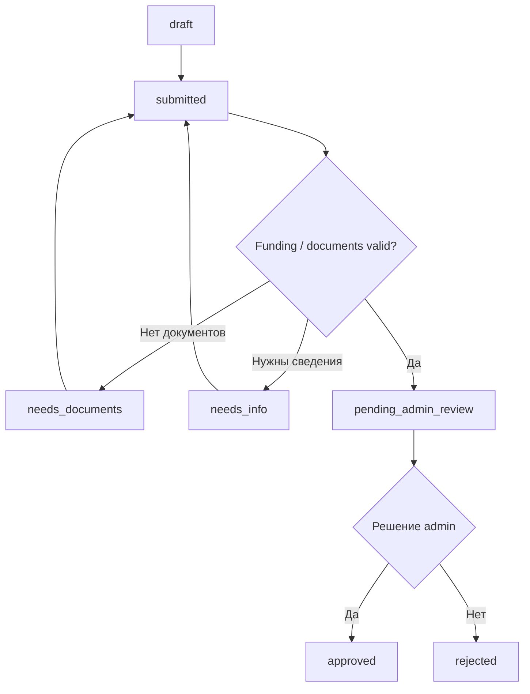

# Пользовательские и административные процессы

Таблицы ниже задают разрешенные состояния. Любой иной переход отклоняется на
сервере и при необходимости создает audit/review task.

## Регистрация и ребенок

Verified parent может создать portal child с именем и датой рождения. Изменение
portal child разрешено owner. Изменение legacy child оформляется как correction
request/admin action. Approved correction записывается как override поверх
отдельно сохраненного source value; reimport обновляет source, но не стирает
override.

## Legacy claim

1. До verification система не делает observable lookup.
2. После verification собираются candidates по всем distinct normalized emails.
3. Пользователь явно подтверждает выбранные families.
4. Conditional transaction проверяет, что family еще не claimed другим user.
5. Family, children и future enrollments связываются идемпотентно.
6. Multiple families/contact conflicts создают review task.
7. Reimport обновляет source data, но не отнимает owner и не стирает manual
   correction.
8. Новый academic period с тем же непротиворечивым `source_namespace+FamilyID`
   наследует claim/owner и stable children; period enrollment snapshots
   создаются заново.
9. Контактный/child конфликт, смена или ошибочное повторное использование
   `FamilyID` создаёт continuity review без автоматической передачи owner.

Name-only, global child-name match и передача already-claimed family запрещены.

## Trial

| Текущее состояние | Действие | Новое состояние |
| --- | --- | --- |
| — | Parent submits | `requested` |
| `requested` | Admin confirms date/capacity | `confirmed` |
| `requested` | Admin rejects with reason | `rejected` |
| `requested|confirmed` | Parent/admin cancels | `cancelled` |
| `confirmed` | Admin records attendance | `attended|no_show` |
| `attended` | Admin starts contract workflow | `converted` |

Только одна open trial на child/course. Confirming проверяет future date,
ownership, отсутствие active enrollment и актуальное состояние capacity. Full
group остается ручным request, а не waitlist.

## Nachhilfe и individual

| Текущее состояние | Действие | Новое состояние |
| --- | --- | --- |
| — | Parent creates | `draft` |
| `draft|needs_documents|needs_info` | Parent submits/resubmits | `submitted` |
| `submitted` | System detects missing required files | `needs_documents` |
| `submitted` | Validation complete | `pending_admin_review` |
| `pending_admin_review` | Admin requests files/details | `needs_documents|needs_info` |
| `pending_admin_review` | Admin decides | `approved|rejected` |
| `draft|submitted|needs_documents|needs_info|pending_admin_review` | Parent cancels | `cancelled` |
| `approved` | Parent/admin cancels before contract/enrollment | `cancelled` |

`draft` можно сохранить без документов. Submitted `individual` всегда
`self_pay`. Submitted `nachhilfe` всегда `jobcenter|socialamt` и требует минимум
один допустимый document перед admin review; self-pay Nachhilfe отклоняется с
переходом к individual request. Для approved public-funding authorization
обязательны authority и valid dates; hours nullable.
`approved_hours_remaining` не рассчитывается в MVP.

`group_nachhilfe` создается только admin и не возникает автоматически из
обычного request.

### Document quarantine

Upload сначала получает `quarantined`. MIME/signature/size validation может
отклонить его, но до решения `OQ-009` она не превращает файл в обычный download.
Уполномоченный admin открывает quarantine только через изолированный viewer;
доступ и решение `approved|rejected` аудируются. `reviewable` используется лишь
после подключения утвержденной автоматической проверки. Parent не получает
прямой/public R2 URL ни в одном состоянии.

## Contract offer

| Текущее состояние | Actor/action | Новое состояние |
| --- | --- | --- |
| — | Admin creates | `draft` |
| `draft` | Generate immutable HTML/PDF, validate snapshots, send | `sent` |
| `sent` | Parent accepts current hash before expiry | `accepted_by_parent` |
| `sent` | Parent declines | `declined_by_parent` |
| `sent` | Deadline passes | `expired` |
| `draft|sent` | Admin cancels | `cancelled` |
| `sent` | Conditions replaced by new version | `superseded` |
| `accepted_by_parent` | Admin approves/forms and activates transactionally | `approved_by_admin` |
| `accepted_by_parent` | Admin cancels with reason when activation is impossible | `cancelled` |
| `accepted_by_parent` | Conditions changed; admin creates new version | `superseded` |

После `sent` offer immutable. Новые условия означают новую version, старую
принять нельзя; acceptance старой version не переносится. Acceptance и
activation имеют разные idempotency keys. Activation атомарно:

- проверяет acceptance/hash/owner/current status;
- фиксирует formation timestamp и обе стороны evidence;
- для group повторно проверяет price/capacity, создаёт/активирует один
  enrollment, связывает represented legacy enrollment и один раз обновляет
  occupancy;
- для individual/Nachhilfe повторно проверяет request/funding status и
  conditional переводит уже связанный draft/contract_offered service
  engagement в active и связывает contract, не меняя group occupancy;
- создаёт audit; только group branch при необходимости создаёт deduped price
  review batch.

Первый individual/Nachhilfe offer series атомарно создаёт draft engagement.
Superseding version переиспользует его. Cancel/decline/expiry последнего open
offer очищает/отменяет неактивный engagement; active record cleanup не затрагивает.

## Price review

1. Триггер создает один batch на course/reason/count/effective date.
2. Система создает item на каждый active enrollment с индивидуальной ценой.
3. Admin может исправить/отменить item и затем approve batch.
4. Notification outbox отправляет каждому только его item.
5. `sent -> accepted` по явному согласию; отказ/timeout →
   `needs_manual_contact`.
6. Accepted item применяется один раз не раньше effective date.
7. Yearly items остаются internal manual review до решения `OQ-001`.

После отправки item immutable и принимается по hash. Любое изменение цены,
effective date или текста создает новую version, а прежняя становится
`superseded`.

Старая цена действует до успешного применения. Ретроактивное изменение
запрещено.

## Support и absence

Обычное обращение создает thread/message. Absence form дополнительно требует
child, enrollment и дату и атомарно создает связанную `absence_report` и message
в thread. Ответ admin сначала сохраняется, затем ставится в email outbox.

| Текущее состояние | Actor/action | Новое состояние |
| --- | --- | --- |
| —/`open` | Parent сохраняет первое сообщение | `waiting_for_admin` |
| `waiting_for_admin` | Admin отвечает и ожидает уточнение | `waiting_for_parent` |
| `waiting_for_admin` | Admin дает финальный ответ | `answered` |
| `waiting_for_parent|answered` | Parent пишет продолжение | `waiting_for_admin` |
| Любое незакрытое | Parent или admin закрывает | `closed` |

`open` допустим только как краткое draft/transactional состояние до первого
message. В `closed` новые сообщения не добавляются; продолжение создает новый
thread со ссылкой на предыдущий. Повтор ответа/закрытия идемпотентен.

Подробности доставки: [MESSAGING.md](MESSAGING.md).
